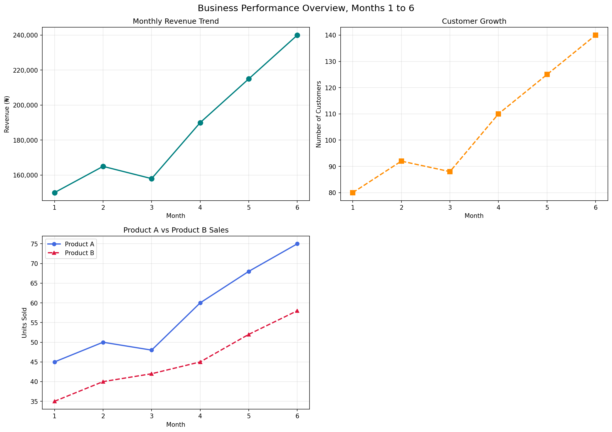

# Visualizing Business Performance with Matplotlib

A Python study project built for the Python Study Group (Coach Timothy Edition). It turns six months of business data into clear charts and a short written report that a business owner can understand.

## Business Problem

A small business owner wants a simple Python based report that gives an overview of revenue, customer growth, and product performance. The business supplied six months of figures and needs them presented visually, together with an honest reading of what the numbers do and do not show.

## Project Objectives

1. Create meaningful visualizations with Matplotlib.
2. Customize charts with titles, axis labels, colors, line styles, markers, and legends.
3. Compare multiple data series on one chart.
4. Arrange several charts in one figure using `plt.subplots()`.
5. Control figure size, axis limits, and spacing.
6. Interpret visual patterns and communicate findings without making unsupported causal claims.

## Repository Structure

```
matplotlib-business-performance/
│
├── matplotlib_exercise.ipynb
├── README.md
└── images/
    └── business_performance_charts.png
```

## Dataset Description

The data covers six months and is written directly into the notebook as Python lists.

* **months:** reporting months 1 to 6
* **revenue:** monthly business revenue in naira (₦150,000 to ₦240,000)
* **customers:** number of customers recorded each month (80 to 140)
* **product_a:** monthly sales quantity for Product A, assumed to be units sold (45 to 75)
* **product_b:** monthly sales quantity for Product B, assumed to be units sold (35 to 58)

The notebook also contains three earlier exercises with their own small datasets: monthly retail sales, customer acquisition by two campaigns, and hospital indicators (patients treated, average waiting time in minutes, and a satisfaction score from 0 to 100). The units for the hospital data and the product data are assumptions made for this exercise. In a real project they would need to be confirmed before reporting.

## Tools and Libraries Used

* Python 3
* Matplotlib (`pyplot`, `ticker`)
* NumPy (used once, to calculate a correlation in Exercise 3)
* Jupyter Notebook or Google Colab

## Summary of the Charts Created

**Mini project figure (2 by 2 layout, three charts used)**

1. **Monthly Revenue Trend:** a line chart of revenue in naira with circular markers.
2. **Customer Growth:** a line chart of customers per month with a dashed line and square markers.
3. **Product A vs Product B Sales:** a line chart with both products on the same axes, different colors and line styles, and a legend. The fourth position in the grid is left empty on purpose.

**Earlier exercises in the same notebook**

* **Exercise 1:** a single line chart of monthly retail sales with each value labelled.
* **Exercise 2:** two campaigns compared on one chart with a legend, then split into two side by side subplots that share the same y axis.
* **Exercise 3:** three vertically stacked subplots for patients treated, average waiting time, and patient satisfaction, each on its own scale.



## Key Observations

1. **Revenue grew strongly overall.** It rose from ₦150,000 in month 1 to ₦240,000 in month 6, an increase of 60%. The only decline was in month 3, when revenue fell by ₦7,000.
2. **Customers followed the same pattern as revenue.** Customer numbers grew from 80 to 140, an increase of 75%, and also fell only in month 3. Revenue and customers moved in the same direction in every month.
3. **Customers grew faster than revenue.** Revenue per customer fell from about ₦1,875 in month 1 to about ₦1,714 in month 6, which means each customer is contributing slightly less on average.
4. **Product A outsold Product B in month 6**, with 75 units against 58. Product A led in every month, but Product B rose in month 3 while Product A fell.

## What the Data Shows and What It Does Not

The data shows the patterns above. It does not explain why they happened. The month 3 dip could be linked to seasonality, stock problems, or a change in marketing, but none of these can be confirmed from this dataset. The same applies to the fall in revenue per customer. Information that would help the owner includes prices and discounts, marketing activity by month, revenue by product, whether customers are new or returning, stock levels, and more months of data.

## How to Run the Notebook

1. Clone the repository:
   `git clone https://github.com/Obadamilare/matplotlib-business-performance.git`
2. Install the requirements:
   `pip install matplotlib numpy notebook`
3. Start Jupyter:
   `jupyter notebook`
4. Open `matplotlib_exercise.ipynb` and choose Run All.

To use Google Colab instead, upload the notebook to Colab and choose Runtime, then Run all. No installation is needed because Matplotlib and NumPy are already available there.

The final figure is saved automatically to `images/business_performance_charts.png`.

## Author

Adekogbon Obadamilare Testimony
GitHub: [Obadamilare](https://github.com/Obadamilare)
